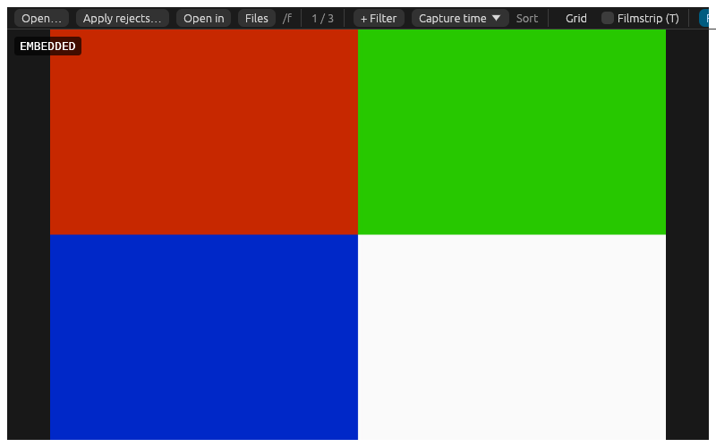

# Gate report M2

Date: 2026-11-21 · Commit: `ae39eb8`

## Gate

M2 gate (SPEC §13): "All M2 IDs traced; perf within budget on CI baselines; report asks the owner
to confirm absolute budgets on his laptop (non-blocking, via HUMAN_TODO)".

- `cargo xtask verify --full` on `9099efd`: **138 tests run: 138 passed, 0 skipped**;
  `trace: 21/45 IDs with passing tests; 21 required` (every M0–M2 ID).
- Main CI green on all 6 targets including "Perf compare (Linux)" (no PERF metric > 10 % over its
  CI baseline): `9099efd` https://github.com/canberkdurmus/blink/actions/runs/44905392248,
  `ae39eb8` (this report's tick commit) https://github.com/canberkdurmus/blink/actions/runs/44906893952.
- Owner confirmation of the absolute budgets on real hardware: added to `HUMAN_TODO.md`.

## Notes for the owner

- **Absolute budgets vs CI.** SPEC §7: absolute budgets are judged on a mid-range laptop, while CI
  only checks for regressions against its baselines. On the agent's machine (Ryzen 7 PRO 7840U,
  16 threads, headless) every M2 budget is met (table below). The 4-core CI runner is over budget on PERF-3
  (81 ms/item ≈ 12 items/s), PERF-4 (54 ms) and PERF-5 (2.0 s). Those numbers are regression
  baselines only. **Please run `cargo xtask bench` on your laptop** (HUMAN_TODO).
- **Headless measurement (ADR 0014).** "Displayed" means the loupe drew the item's textures in a
  frame of a real `BlinkApp` with no renderer. GPU upload and vsync are not timed. In particular
  PERF-5's "no UI frame > 33 ms" excludes uploading the full-resolution tiles. Please check by eye
  that zoom to 100 % on a 45 MP RAW doesn't stutter.
- **PERF-5 scenario.** The corpus's 45 MP file (ILCE-1M2) has a full-size embedded preview, so
  VIEW-4 correctly never decodes the RAW on zoom. The bench forces the decode with
  `Action::DecodeRaw` (ADR 0014).
- **PERF-3 fix during the gate (#15).** After #14 merged, main's perf job failed: PERF-3 measured
  120 ms, then 274 ms/item on rerun, for the same tree that measured 107 ms on the PR. The
  decode-ahead lead was capped at the 8-item prefetch window. On a host where one decode spans
  more than 8 key repeats, every decode finished on an item already passed. `Show` now lists up
  to 32 items ahead for pacing. The SPEC §8.3 prefetch window is unchanged. CI PERF-3 went from
  104 to 81 ms/item. One core test assertion ("ahead ⊆ prefetch") was relaxed in its own commit
  with a `test-fix:` trailer.
- **OPEN-1 GUI entry points** (drop, Ctrl+O dialog via `rfd`, `blink [folder|file]`) shipped in #14
  (ADR 0013). A bare relative file name (`blink IMG.ARW`) opened an empty folder. The reviewer
  caught it and it was fixed before the merge.
- **Baselines.** The Linux CI baselines were recorded in #14 (`golden-update:` trailer, run
  44888085300). They were not lowered after the PERF-3 fix.

## IDs closed

| ID | Passing tests (last full run) |
|---|---|
| VIEW-1 | `req_view_1_opening_shows_the_first_item_fit_with_its_embedded_preview`, `req_view_1_navigation_moves_the_current_item_and_never_shows_stale_pixels`, `req_view_1_fit_scales_the_image_into_the_viewport_and_centres_it`, `req_view_1_first_item_shows_its_embedded_preview_and_neighbours_are_prefetched`, `req_view_1_heif_and_unreadable_files_show_no_preview`, `req_view_1_a_running_prefetch_still_wanted_by_a_newer_show_is_not_dropped`, `req_view_1_a_load_in_flight_during_clear_never_fills_the_cache`, `req_view_1_command_line_folder_opens_in_the_loupe_fit_with_the_embedded_preview`, `req_view_1_arrow_keys_move_and_no_frame_shows_a_stale_item`, `req_view_1_loupe_screenshot_golden` |
| VIEW-4 | `req_view_4_zoom_on_low_res_raw_loads_the_raw_decode_and_swaps_it_in`, `req_view_4_paired_jpeg_is_named_in_the_full_request_and_failure_clears_the_spinner`, `req_view_4_zoom_at_cursor_keeps_the_point_under_the_cursor`, `req_view_4_full_resolution_is_needed_only_when_the_preview_would_be_upscaled`, `req_view_4_raw_decode_has_the_sensor_crop_size_on_every_decodable_corpus_file`, `req_view_4_zoom_100_on_low_res_raw_ends_with_raw_decode_at_sensor_size`, `req_view_4_zoom_on_low_res_raw_with_a_paired_jpeg_uses_the_jpeg`, `req_view_4_zoom_on_low_res_arw_ends_with_raw_decode_at_sensor_size`, `req_view_4_z_zooms_to_100_percent_with_every_pixel_and_req_view_9_keeps_it_on_the_next_item` |
| VIEW-6 | `req_view_6_clipping_and_info_panel_toggle`, `req_view_6_clipping_mask_is_exact_on_a_synthetic_image`, `req_view_6_thresholds_are_254_any_channel_and_1_all_channels`, `req_view_6_histograms_are_exact_and_labelled_with_the_source`, `req_view_6_overlay_tiles_colour_clipped_pixels`, `req_view_6_j_toggles_the_clipping_overlay_and_i_shows_the_labelled_histogram` |
| VIEW-9 | `req_view_9_zoom_position_is_kept_on_the_next_item_and_toggleable`, `req_view_9_zoom_levels_are_fit_50_100_200_of_the_full_image`, `req_view_9_pan_with_drag_moves_the_image_and_stays_inside`, `req_view_4_z_zooms_to_100_percent_with_every_pixel_and_req_view_9_keeps_it_on_the_next_item` |
| PERF-1 | `blink-ui::perf::full_perf::req_perf_1_launch_to_first_image_with_2000_raws` |
| PERF-2 | `blink-ui::perf::full_perf::req_perf_2_next_item_prefetched_is_drawn_at_once` |
| PERF-3 | `blink-core::state::tests::req_perf_3_ahead_reaches_past_the_prefetch_window_for_slow_decodes`, `blink-core::state::tests::req_perf_3_show_lists_the_items_ahead_in_the_travel_direction_nearest_first`, `blink-runtime::loader::pace_tests::req_perf_3_a_frame_that_merges_key_repeats_keeps_the_run`, `blink-runtime::loader::pace_tests::req_perf_3_a_lead_past_the_prefetch_window_decodes_a_short_run_from_the_lead`, `blink-runtime::loader::pace_tests::req_perf_3_lead_is_the_first_item_not_passed_when_a_decode_ends`, `blink-runtime::loader::pace_tests::req_perf_3_lead_is_zero_while_decodes_keep_up`, `blink-runtime::loader::pace_tests::req_perf_3_lead_items_go_first_and_the_current_item_first_once_settled`, `blink-runtime::loader::pace_tests::req_perf_3_steady_steps_measure_the_interval_and_a_stop_settles`, `blink-ui::perf::full_perf::req_perf_3_held_arrow_key_never_shows_a_stale_item` |
| PERF-5 | `blink-core::state::tests::req_perf_5_decode_raw_requests_a_raw_decode_even_with_a_full_size_preview_or_jpeg`, `blink-ui::perf::full_perf::req_perf_5_full_raw_decode_45mp_for_100_percent_zoom` |

## CI runs

| Workflow | Result | Commit | Link |
|---|---|---|---|
| CI |  | ae39eb8bdb91c34772f9297759e72f462f1754ec | https://github.com/canberkdurmus/blink/actions/runs/44906893952 |
| CI | success | 2a624ff100821110c77628d61c7faa156bf8a73b | https://github.com/canberkdurmus/blink/actions/runs/44905418514 |
| CI | success | 9099efdec48208958088dcf55d34a2847e009d91 | https://github.com/canberkdurmus/blink/actions/runs/44905392248 |
| CI | failure | 817a8be819b45ac67c0507dad7b58bd3f1397881 | https://github.com/canberkdurmus/blink/actions/runs/44901319504 |
| Nightly | success | 56e3cbbda9e1ff1e8ca399470efaffc32ecae47b | https://github.com/canberkdurmus/blink/actions/runs/44891381092 |
| CI | success | 56e3cbbda9e1ff1e8ca399470efaffc32ecae47b | https://github.com/canberkdurmus/blink/actions/runs/44834953412 |
| CI | success | 95500244ac7d7d5ef8ff3ea717f0915e53173ad7 | https://github.com/canberkdurmus/blink/actions/runs/44832061626 |
| CI | success | 2ca306810857b52aac2792a82d62eee6261c8af6 | https://github.com/canberkdurmus/blink/actions/runs/44804560404 |

## Performance

CI runner (main `ae39eb8`, run 44906893952, linux-x86_64, 4 cores), raw runs in ms:

| ID | Median ms | Budget ms | Baseline ms | Raw runs ms |
|---|---|---|---|---|
| PERF-1 | 175.1 | 400.0 | 184.9 | 181.1, 161.1, 215.0, 175.1, 148.2 |
| PERF-2 | 0.6 | 16.0 | 0.5 | 21 presses, 0.35–0.68 |
| PERF-3 | 81.3 | 33.3 | 103.9 | 77.2, 73.4, 81.5, 81.3, 94.0 |
| PERF-4 | 54.0 | 25.0 | 65.9 | 53.7, 53.8, 54.0, 54.5, 54.6 |
| PERF-5 | 2001.4 | 1500.0 | 1999.5 | 2022.6, 2003.9, 1997.4, 2001.4, 1987.6 |
| PERF-5/frame | 0.2 | 33.0 | 0.2 | 0.24, 0.22, 0.25, 0.22, 0.22 |

Agent's machine (Ryzen 7 PRO 7840U, `cargo xtask bench` on `9099efd`):

Target `linux-x86_64`, `cargo xtask bench`, release build.

| ID | Median ms | Budget ms | Raw runs ms |
|---|---|---|---|
| PERF-1 | 165.2 | 400.0 | 224.8, 191.7, 131.7, 165.2, 151.8 |
| PERF-2 | 0.6 | 16.0 | 0.3, 0.7, 0.4, 0.4, 0.5, 0.4, 0.6, 0.9, 0.9, 0.8, 0.8, 0.8, 0.6, 0.8, 0.6, 0.3, 0.9, 0.6, 0.5, 0.4, 0.3 |
| PERF-3 | 25.1 | 33.3 | 25.0, 25.1, 25.0, 25.1, 25.1 |
| PERF-4 | 20.1 | 25.0 | 19.7, 20.1, 20.1, 20.5, 22.2 |
| PERF-5 | 771.6 | 1500.0 | 774.0, 774.2, 767.6, 771.6, 766.0 |
| PERF-5/frame | 0.9 | 33.0 | 4.4, 1.1, 0.9, 0.8, 0.8 |

Vs CI baseline for this target (a different machine; the regression check that counts is the CI job above):

```
ID        median ms  budget ms   baseline    delta  status
PERF-1        165.2      400.0      184.9   -10.7%  ok, within budget
PERF-2          0.6       16.0        0.5   +23.8%  ok, within budget
PERF-3         25.1       33.3      103.9   -75.8%  ok, within budget
PERF-4         20.1       25.0       65.9   -69.4%  ok, within budget
PERF-5        771.6     1500.0     1999.5   -61.4%  ok, within budget
PERF-5/frame        0.9       33.0        0.2  +334.5%  ok, within budget
```


## Screenshots

Linux wgpu screenshot golden of the loupe (`req_view_1_loupe_screenshot_golden`):



## Open BLOCKED.md items

None.

## ADRs

- [0001-record-architecture-decisions.md](../adr/0001-record-architecture-decisions.md)
- [0002-m0-dependencies.md](../adr/0002-m0-dependencies.md)
- [0003-requirement-tracing-and-test-tiers.md](../adr/0003-requirement-tracing-and-test-tiers.md)
- [0004-ci-runners.md](../adr/0004-ci-runners.md)
- [0005-milestone-prereleases.md](../adr/0005-milestone-prereleases.md)
- [0006-corpus.md](../adr/0006-corpus.md)
- [0007-plat-2-directories-and-portable-mode.md](../adr/0007-plat-2-directories-and-portable-mode.md)
- [0008-decode-pipeline-and-dependencies.md](../adr/0008-decode-pipeline-and-dependencies.md)
- [0009-xmp-reading.md](../adr/0009-xmp-reading.md)
- [0010-m1-headless-scope-of-open-and-marks.md](../adr/0010-m1-headless-scope-of-open-and-marks.md)
- [0011-perf-4-parallel-baseline-jpeg-decoder.md](../adr/0011-perf-4-parallel-baseline-jpeg-decoder.md)
- [0012-loupe-state-and-image-loader.md](../adr/0012-loupe-state-and-image-loader.md)
- [0013-gui-dialog-and-ui-tests.md](../adr/0013-gui-dialog-and-ui-tests.md)
- [0014-gui-perf-bench-scripts.md](../adr/0014-gui-perf-bench-scripts.md)

## Pre-release

https://github.com/canberkdurmus/blink/releases/tag/v1.0.0-m2


Release build (all 6 targets): https://github.com/canberkdurmus/blink/actions/runs/44906903276

- https://github.com/canberkdurmus/blink/releases/download/v1.0.0-m2/blink-v1.0.0-m2-linux-arm64.tar.gz
- https://github.com/canberkdurmus/blink/releases/download/v1.0.0-m2/blink-v1.0.0-m2-linux-x86_64.tar.gz
- https://github.com/canberkdurmus/blink/releases/download/v1.0.0-m2/blink-v1.0.0-m2-macos-arm64.tar.gz
- https://github.com/canberkdurmus/blink/releases/download/v1.0.0-m2/blink-v1.0.0-m2-macos-x86_64.tar.gz
- https://github.com/canberkdurmus/blink/releases/download/v1.0.0-m2/blink-v1.0.0-m2-windows-arm64.zip
- https://github.com/canberkdurmus/blink/releases/download/v1.0.0-m2/blink-v1.0.0-m2-windows-x86_64.zip
